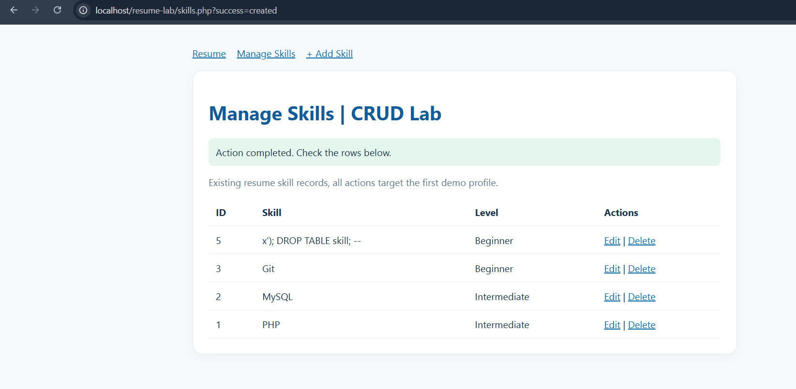

# Task 4: อธิบาย WHERE และ Parameter Binding

## ทำไม UPDATE และ DELETE ต้องมี WHERE

WHERE ระบุว่าจะให้คำสั่งทำงานกับแถวไหน ถ้าไม่มี WHERE คำสั่งจะกระทบทุกแถวในตาราง เช่น `DELETE FROM skill` จะลบ skill ทั้งหมด และ `UPDATE skill SET skill_level = 'Beginner'` จะเปลี่ยนทุกแถว ในงานนี้ใช้ `WHERE id = ? AND profile_id = ?` เพื่อให้แก้หรือลบได้เฉพาะแถวที่เลือก และเป็นของ profile ที่กำหนดเท่านั้น

## Parameter binding

โค้ดเขียน SQL ด้วยตัวแทน `?` แล้วใช้ `mysqli_stmt_bind_param` ส่งค่าแยกต่างหาก เช่น `bind_param($stmt, 'ssii', $name, $level, $id, $pid)` ทำให้ฐานข้อมูลถือว่าค่าที่ผู้ใช้กรอกเป็นข้อมูล ไม่ใช่ส่วนของคำสั่ง SQL จึงป้องกัน SQL injection ได้ เช่น ถ้ากรอกชื่อ skill เป็น `x'); DROP TABLE skill; --` ก็จะถูกเก็บเป็นข้อความธรรมดา

ตัวอย่างโค้ดจาก `skill_create.php`:

```php
$sql = 'INSERT INTO skill (profile_id, skill_name, skill_level) VALUES (?, ?, ?)';
$stmt = mysqli_prepare($conn, $sql);
mysqli_stmt_bind_param($stmt, 'iss', $pid, $name, $level);
mysqli_stmt_execute($stmt);
```

- `?` คือช่องว่างที่รอรับค่า โครงสร้างคำสั่ง SQL ถูกกำหนดก่อน
- `iss` คือชนิดของค่า: `i` = ตัวเลข, `s` = ข้อความ
- ค่าที่ผู้ใช้กรอกถูกส่งแยกจากคำสั่ง SQL จึงไม่สามารถเปลี่ยนความหมายของคำสั่งได้

## ผลการทดสอบ

ทดสอบในเครื่อง (localhost) โดยกรอกชื่อ skill เป็น `x'); DROP TABLE skill; --` ระบบบันทึกเป็นข้อความธรรมดา และตาราง skill ยังอยู่ครบ

